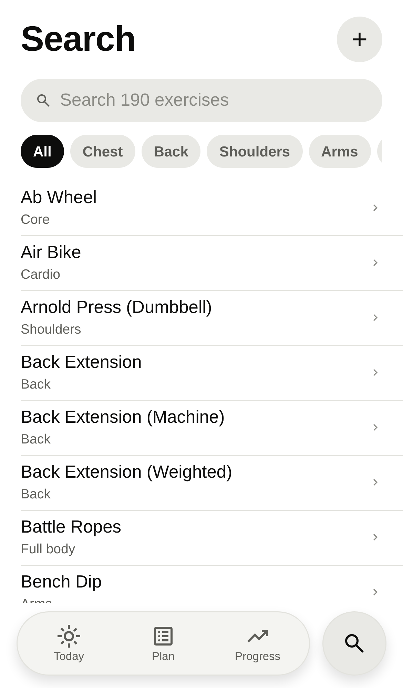
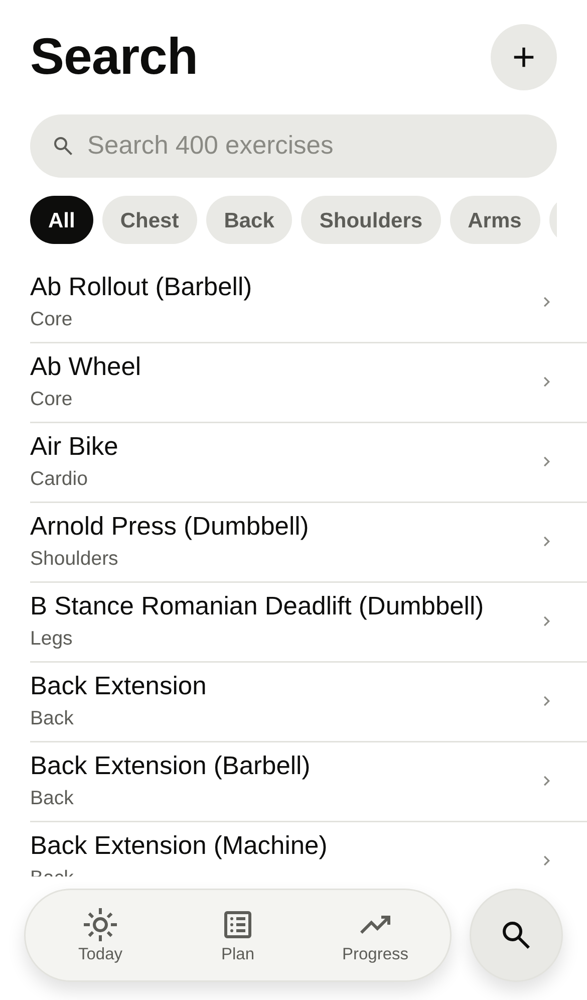
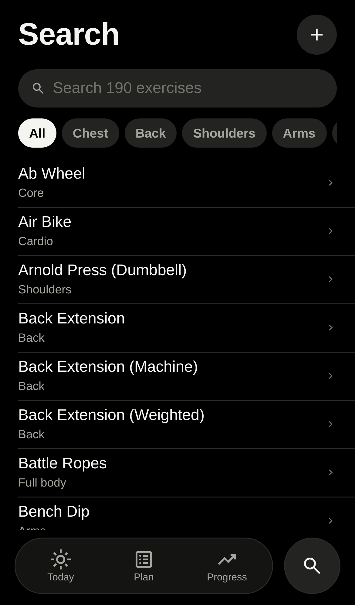
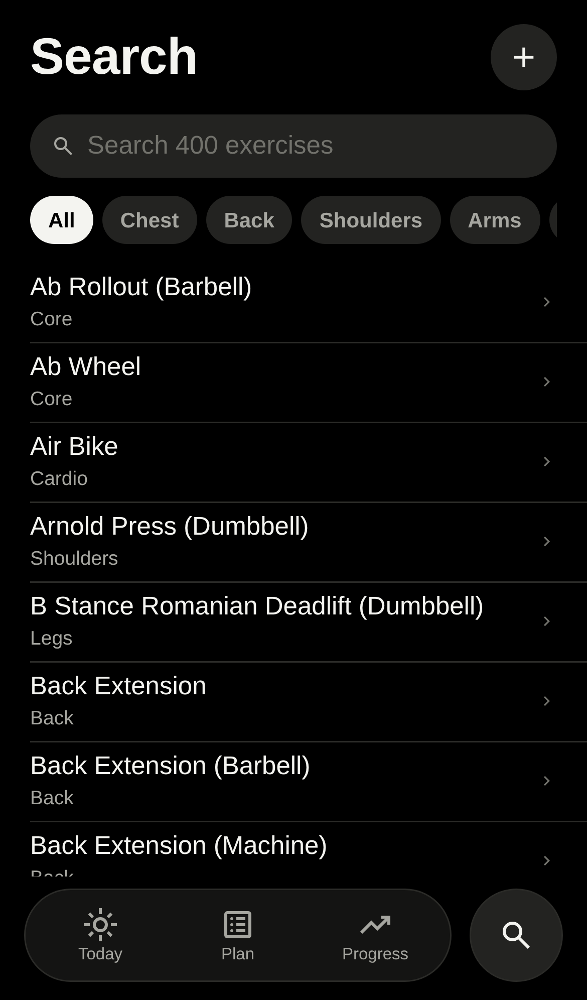
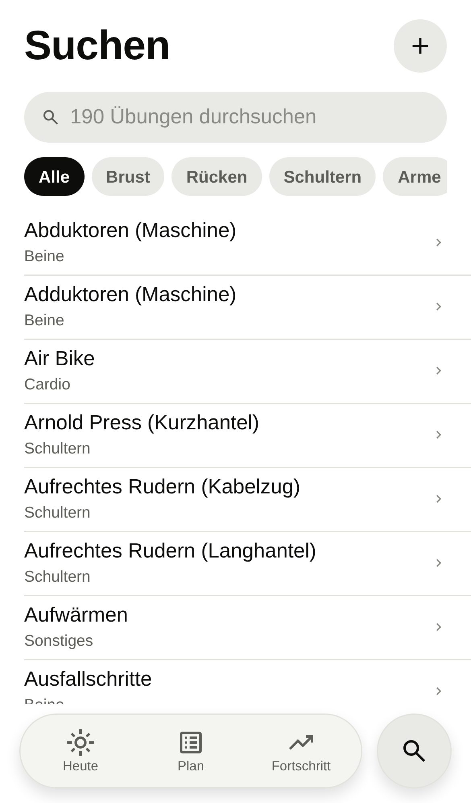
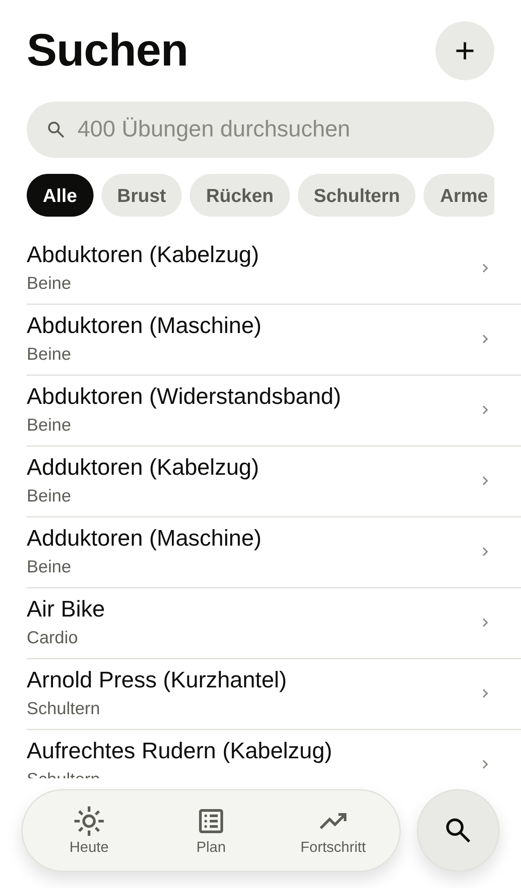
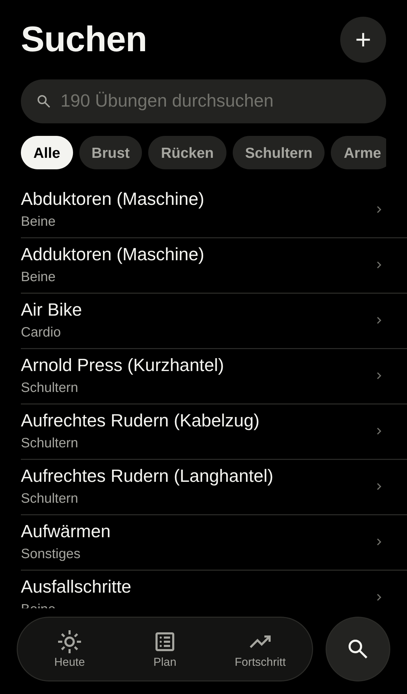
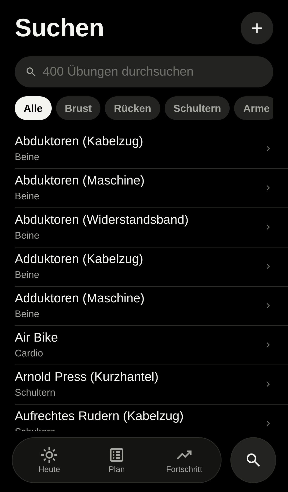

# Exercise catalogue review

PR #12, catalogue/core only. The [generated table](catalogue.md) contains all **400 exercises in 94 families**, with English/German names, ids, logging fields, body parts and compatibility notes. It follows the intended tab order: main movement first, related movements adjacent and equipment in the common core order.

The latest review separates Split Squat, Romanian Deadlift, Sissy Squat, Copenhagen Plank and Kelso Shrug, and moves Glute Bridge under Hip Thrust. It adds plate/machine Neck Curl and Neck Extension, Chest Supported T Bar Row, Kroc Row, Donkey Calf Raise (Machine) and Dead Hang. The [source audit](../exercise-sources.md) checks each addition against two sources. The original 190 exercise records and example routines are unchanged.

Search still shows individual exercises; family rows and tabs come in PR 2. These captures show the expanded catalogue in the current screen. The before images are from `main` at `c96e59b` (190 exercises), reused from the previous review commit `4b783a3`. After images are from this revision (400 exercises). Both use fresh local data, the same Search screen and iPhone 13 emulation. `tests/browser/exercise-review-shots.mjs` checks the stored count and browser errors in each language/theme.

| Search | Before | After |
|---|---|---|
| English, light |  |  |
| English, dark |  |  |
| German, light |  |  |
| German, dark |  |  |

This folder is committed for review and removed in the immediately following commit. The PR links to the commit that contains it.
