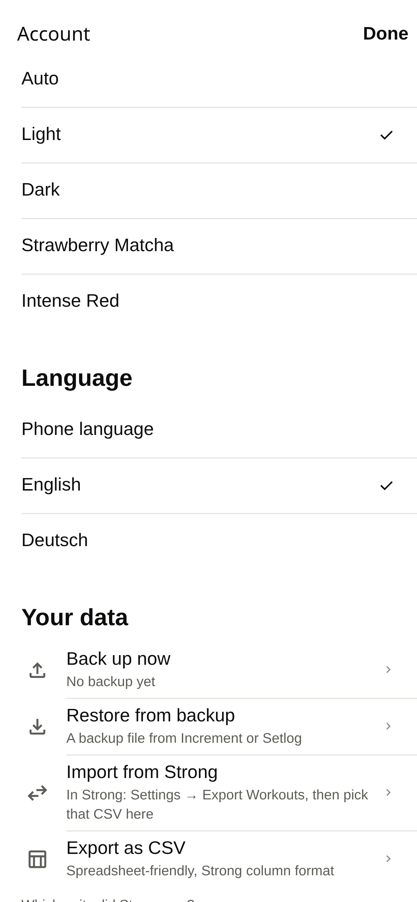
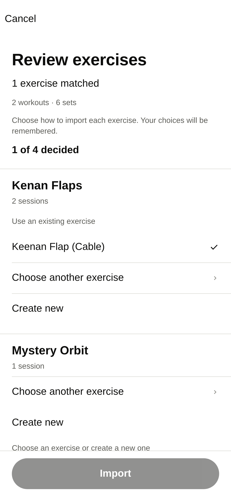
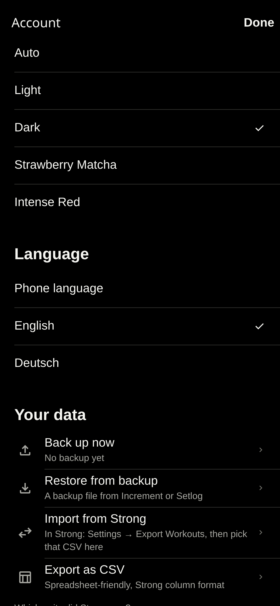
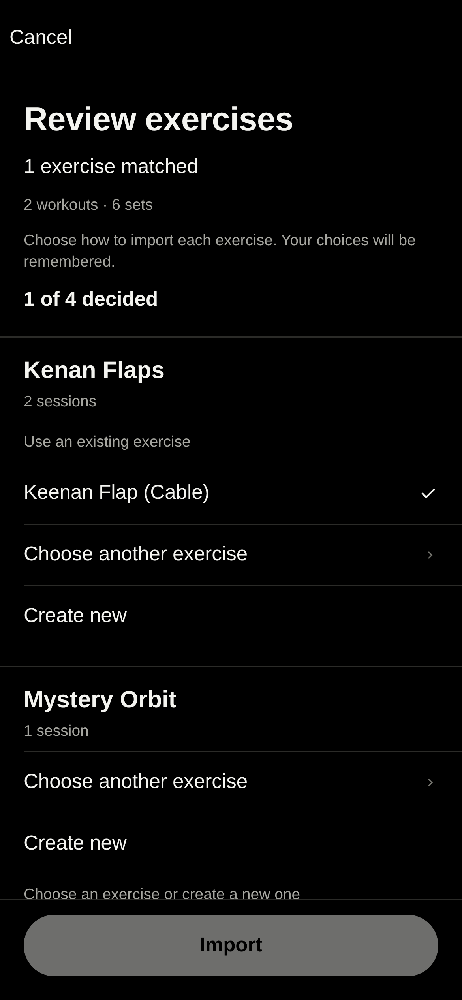
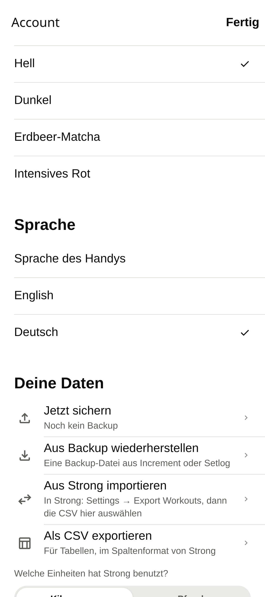
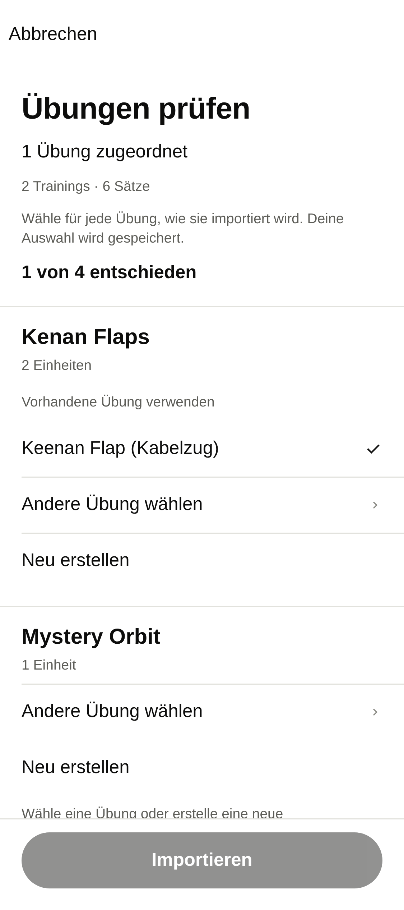
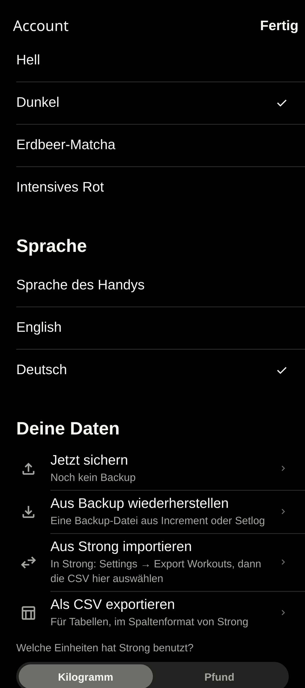
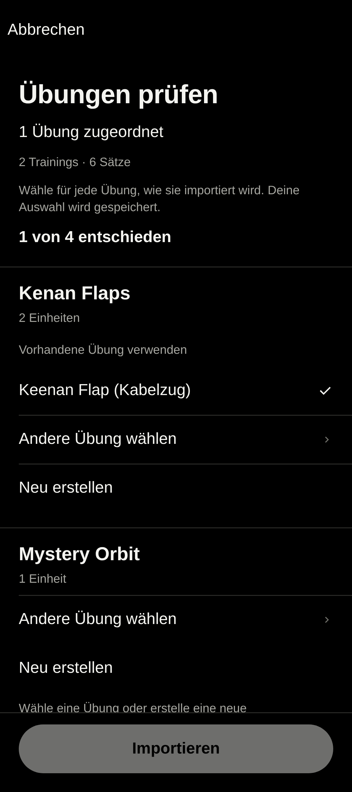

# Strong import exercise review

Before: main at `ee7cddc` (PR #12 merged). After: `import/strong-exercise-review`.

The same CSV contains an exact Bench Press, “Kenan Flaps” in two sessions, “Mystery Orbit” with an unknown body part, a timed “Keenan Flaps”, and “Squat (Cybex Machine)”. Before, Account opened a system confirmation proposing four new exercises. There was no review screen. The browser's system dialog is outside page screenshots, so its actual text is captured in the linked text files rather than redrawn as a mockup.

English uses 390 px, German 375 px; both are the Chromium web build with iPhone emulation. These are layout screenshots, not native-device captures.

| Language / theme | Before: Account | Before: actual confirmation text | After: review |
|---|---|---|---|
| English / light |  | [Confirmation](en-light-confirmation.txt) |  |
| English / dark |  | [Confirmation](en-dark-confirmation.txt) |  |
| German / light |  | [Confirmation](de-light-confirmation.txt) |  |
| German / dark |  | [Confirmation](de-dark-confirmation.txt) |  |

The preselected suggestion is visible, but Import stays disabled while the other rows need decisions. The timed exercise has no weighted suggestions. Its manual picker also contains only compatible exercises and cannot create anything before Import.

| State | English light | English dark | German light | German dark |
|---|---|---|---|---|
| Editable name, unknown body part required | [View](en-light-new.png) | [View](en-dark-new.png) | [View](de-light-new.png) | [View](de-dark-new.png) |
| Exact base joins Squat; every decision complete | [View](en-light-family.png) | [View](en-dark-family.png) | [View](de-light-family.png) | [View](de-dark-family.png) |
| Manual picker restricted to time | [View](en-light-picker.png) | [View](en-dark-picker.png) | [View](de-light-picker.png) | [View](de-dark-picker.png) |

[Second import after reload](en-light-remembered.png): all five exercises match without review rows. Existing workouts are skipped. A newer export reuses the same exercise IDs; backups carry the mapping too.

The browser suite also verifies Cancel writes nothing, an actual import preserves all sets/notes, and a failed storage write leaves the import unsaved and retryable. The core tests cover conservative matching, compatibility, required decisions, shipped aliases, session counts, unit conversion, duplicate imports, missing notes, backup round trips and exact family assignment.

Review assets are committed here and removed in the immediately following commit, as required by AGENTS.md. The PR links this commit so they remain reviewable.

Validation: 66 core tests; all 14 browser suites, with the final import/first-start/parity rerun passing 21/15/13 checks; TypeScript; fresh iOS and Android exports. `expo lint` was attempted, but this repository has no ESLint configuration and Expo's automatic setup failed while creating its user cache. No lint dependencies or configuration were added.
