# Helper muscles — review, 16 Nov 2026

Real browser captures at 390 × 844 CSS px, DPR 1. Before is main at `cc3900cf1e076dd65bb7b77efe902a6d6be7b4da`; after is this branch. The same week has 4 squat sets, 3 Romanian deadlift sets and 4 hip-thrust sets. Images are side by side at their original size; screen content is unchanged.

Before Glutes has only the 4 direct sets. After it has 7½: 4 direct plus 2 from squats and 1½ from Romanian deadlifts. The form compares the old main-muscle choices with the new Also works section.

Reproduce with `app-muscle-sets.mjs` and `REVIEW_HELPERS_BEFORE=1`, as described in `tests/browser/README.md`.

## EN · light

### form

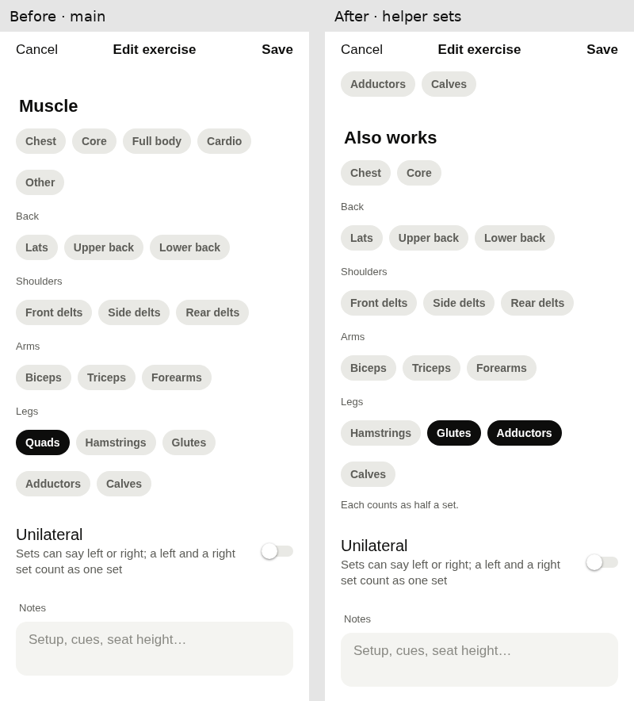

### glutes

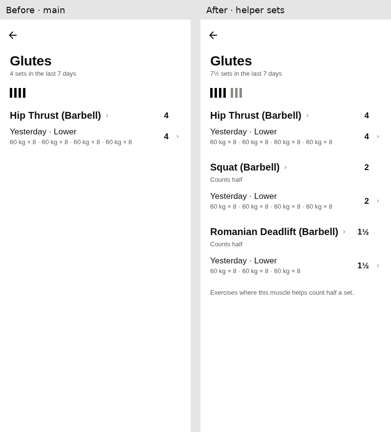

### today

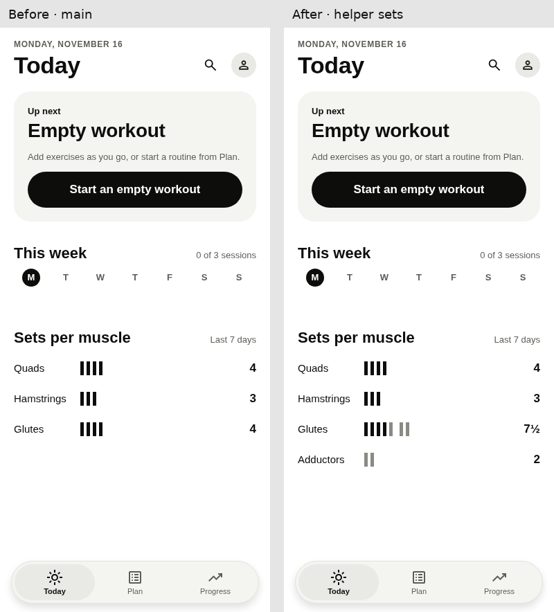

## EN · dark

### form

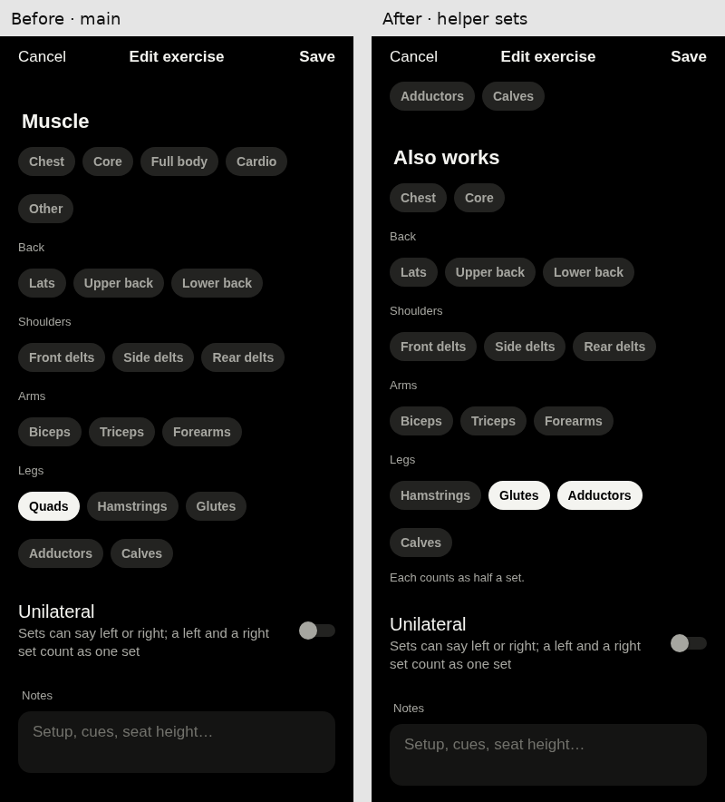

### glutes

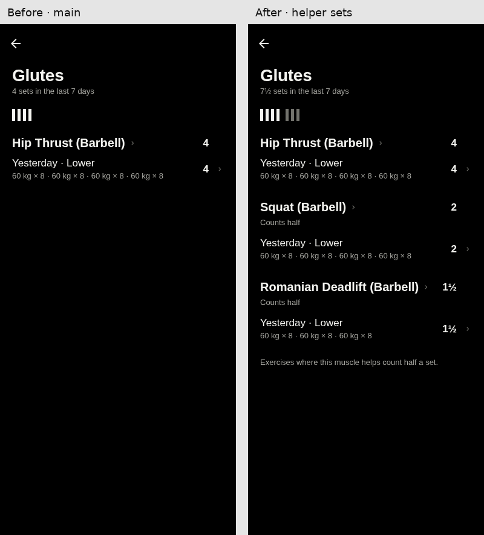

### today

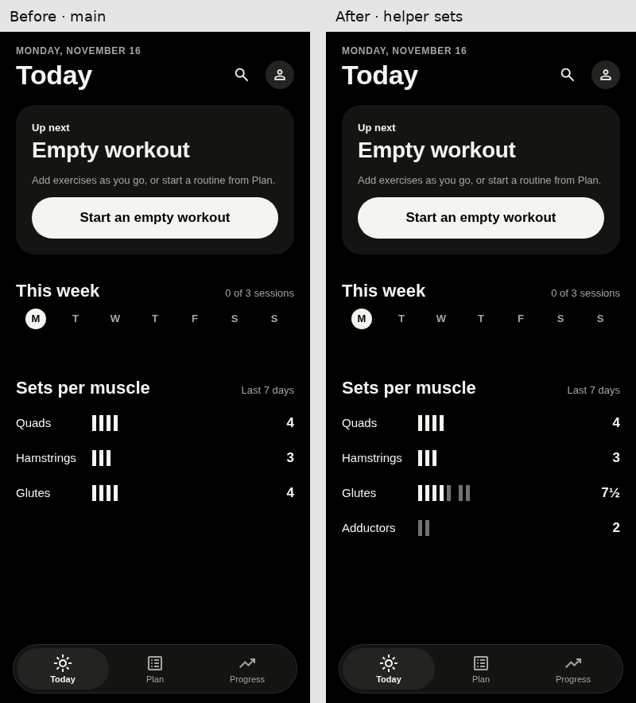

## DE · light

### form

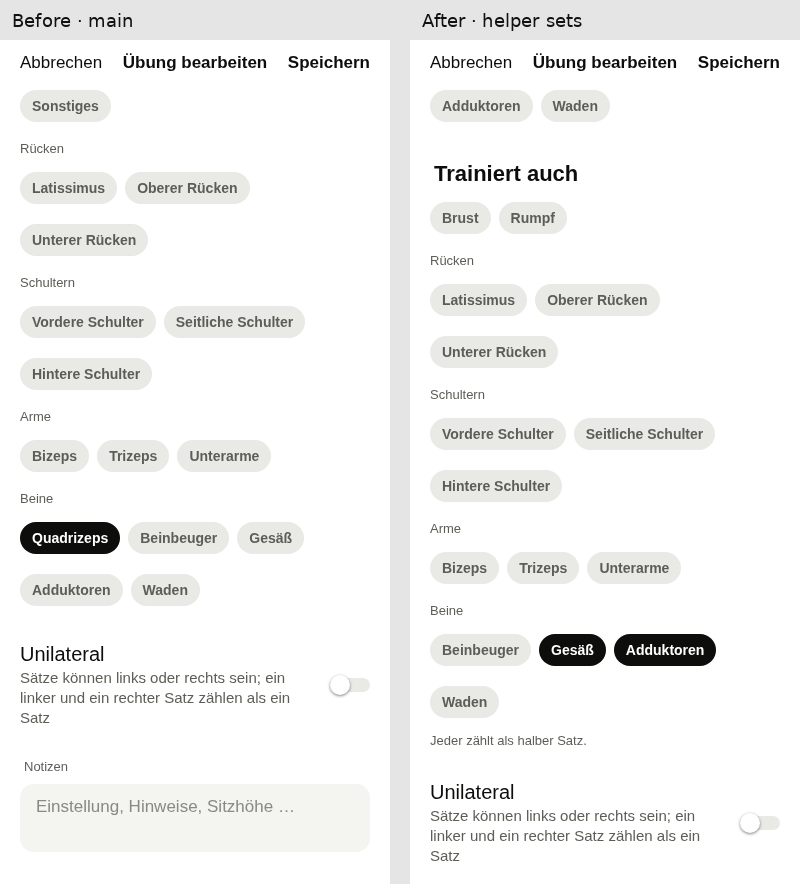

### glutes

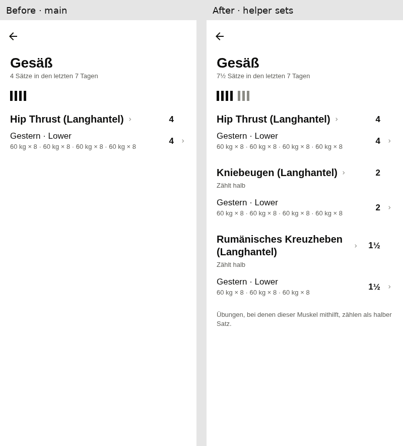

### today

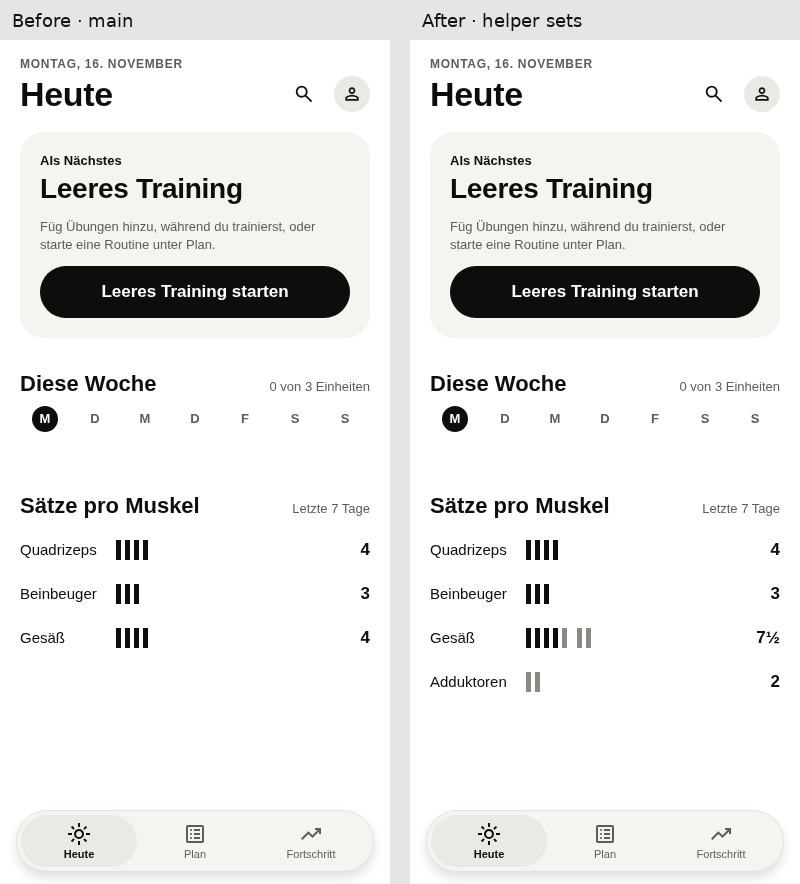

## DE · dark

### form

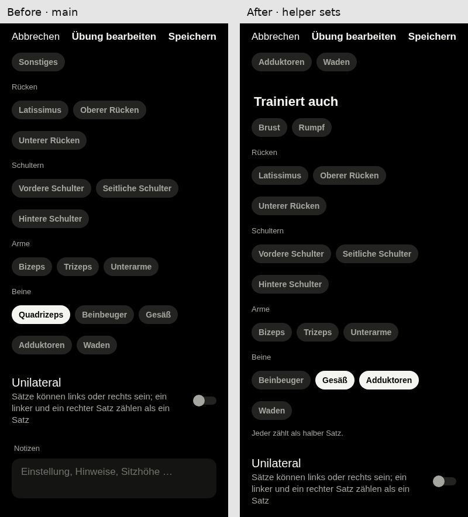

### glutes

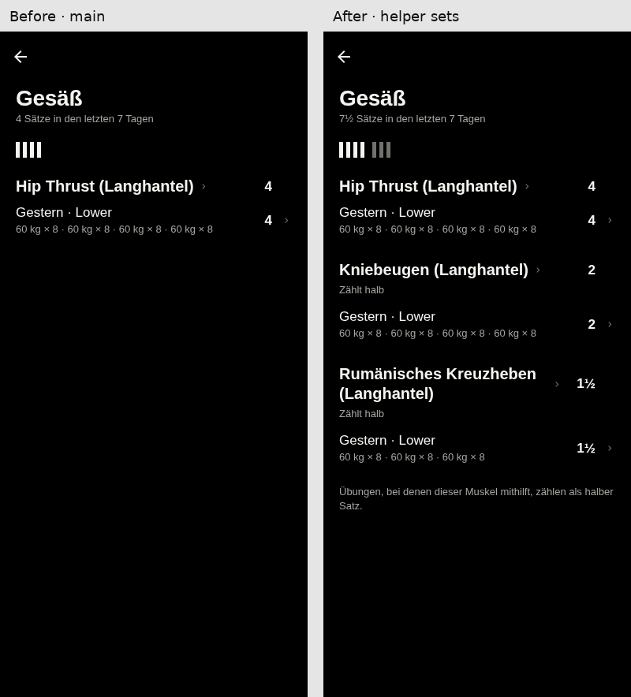

### today

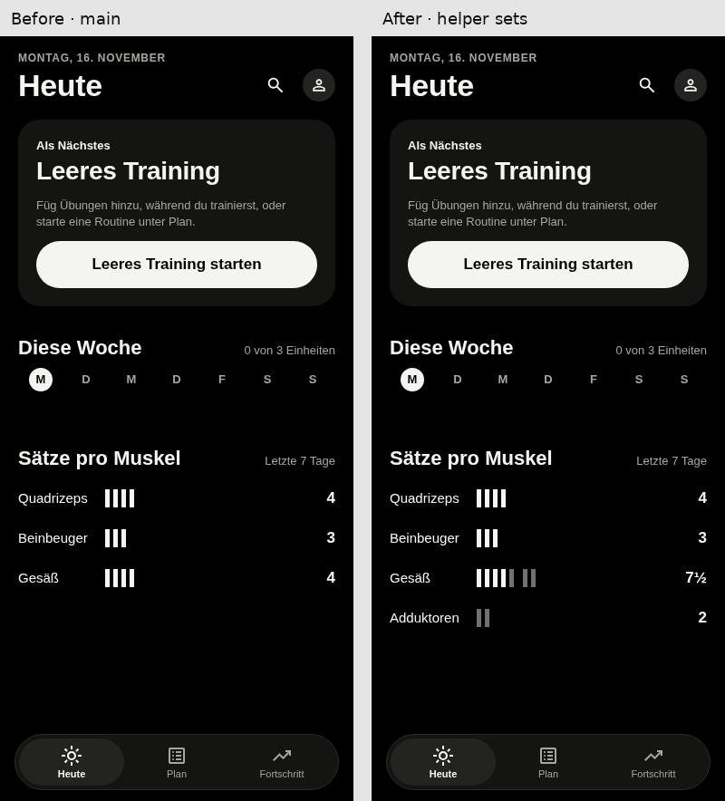
