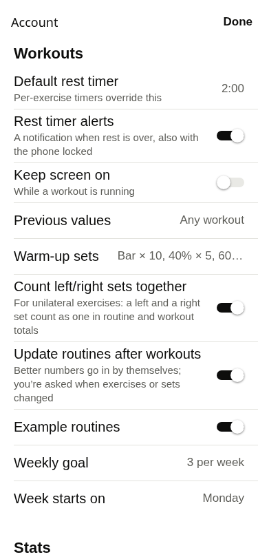
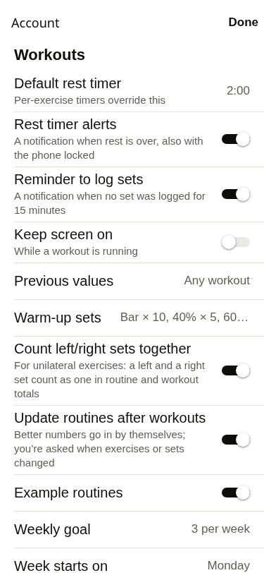
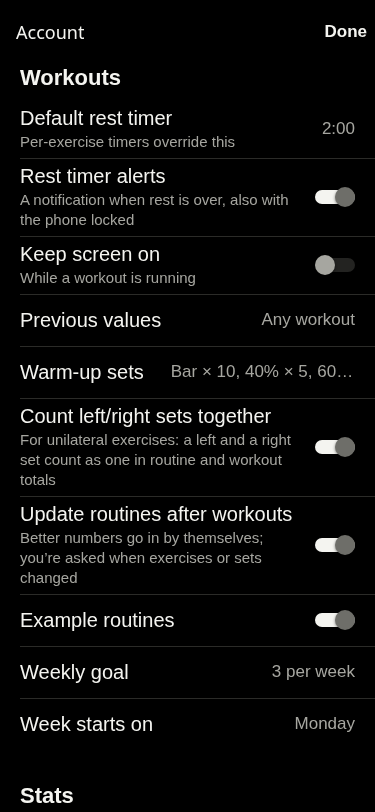
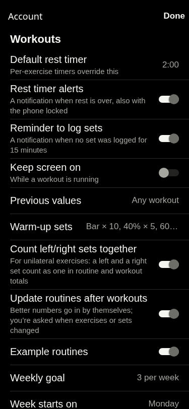
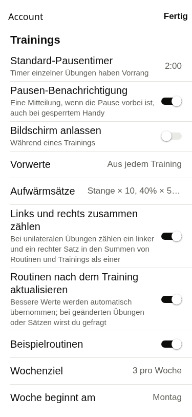
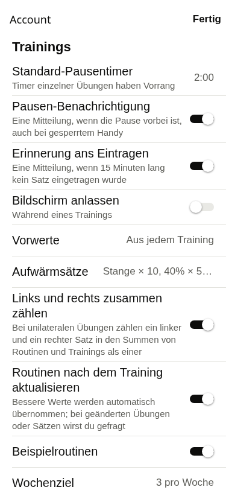
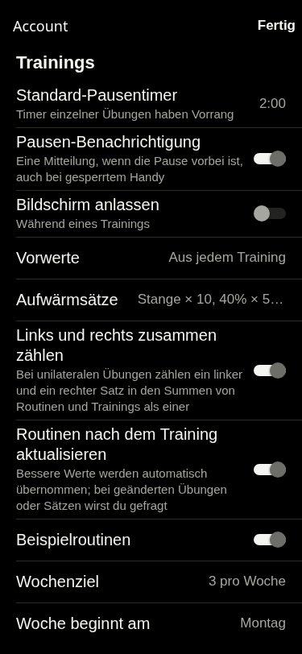
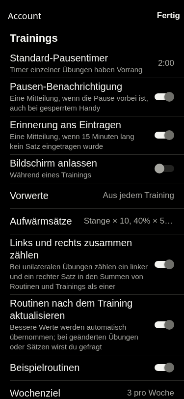

# Account → Workouts: reminder to log sets

Same fixture at 375 × 812 CSS pixels, DPR 1, English and German, light and dark. Before: main at `bfe96e6`. After: #117 implementation. German enabled for both builds.

Captured with `tests/browser/review-log-reminder.mjs`, using `APP` and `REVIEW_BEFORE=1` for the baseline.

| | Before | After |
|---|---|---|
| English, light |  |  |
| English, dark |  |  |
| German, light |  |  |
| German, dark |  |  |

Browser suites cannot show a native notification. No notification screenshot is included; delivery and taps need the phone checks listed in the backlog.
